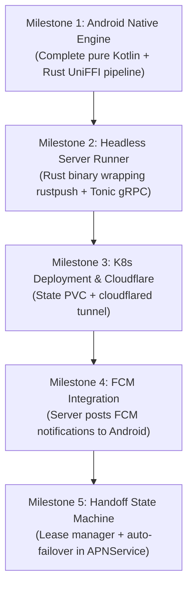

# Hybrid Architecture: Kubernetes Server with Native Mobile Failover

## 1. Architectural Overview

This document outlines the architecture for running a headless OpenBubbles core in **Kubernetes** behind a **Cloudflare Ingress / Tunnel**, with **gRPC** communication, **Firebase Cloud Messaging (FCM)** push wakeups, and an **Active-Passive failover** to the native Android phone engine.

### High-Level Topology

```
                                  ┌────────────────────────┐
                                  │   Apple APNs & IDS     │
                                  └───────────┬────────────┘
                                              │
                      ┌───────────────────────┴───────────────────────┐
                      │ (Normal: Primary TLS Socket)                  │ (Failover: Cell TLS)
                      ▼                                               ▼
         ┌─────────────────────────┐                     ┌─────────────────────────┐
         │   Kubernetes Cluster    │                     │      Android Phone      │
         │  (Home Lab / Server)    │                     │  (Dual-Mode Core)       │
         │                         │                     │                         │
         │ ┌─────────────────────┐ │                     │ ┌─────────────────────┐ │
         │ │ openbubbles-server  │ │                     │ │ Standalone APNService│ │
         │ │ (Tonic gRPC / Rust) │ │                     │ │ (Rust UniFFI/NDK)   │ │
         │ └──────────┬──────────┘ │                     │ └──────────▲──────────┘ │
         │            │            │                     │            │ (Fallback) │
         │ ┌──────────▼──────────┐ │                     │ ┌──────────┴──────────┐ │
         │ │ cloudflared Ingress │ │                     │ │ gRPC Client Service │ │
         │ └──────────▲──────────┘ │                     │ └──────────▲──────────┘ │
         └────────────┼────────────┘                     └────────────┼────────────┘
                      │ (HTTP/2 gRPC over TLS)                        │
                      ▼                                               │
         ┌─────────────────────────┐                                  │
         │   Cloudflare Edge CDN   │◄─────────────────────────────────┘
         │ (Handles Dynamic IP /   │
         │  gRPC Proxying / mTLS)  │◄───────────────┬─────────────────┐
         └────────────┬────────────┘                │                 │
                      │ (FCM Push)                  │                 │
                      ▼                             ▼                 ▼
             [Firebase FCM Gateway]           ┌───────────┐     ┌───────────┐
                      │                       │  Tablet   │     │  Chrome   │
                      └──────────────────────►│(Thin Clnt)│     │(gRPC-Web) │
                                              └───────────┘     └───────────┘
```

---

## 2. Key Components & Code Points

### 2.1 Server Daemon (`openbubbles-server`)
The server runner is a headless Rust service leveraging [`tokio`](file:///media/leo/ExtSSD/IdeaProjects/openbubbles-app/rust/Cargo.toml) and [`tonic`](https://github.com/hyperium/tonic) (gRPC).

#### Code to Reuse / Copy from `rustpush` & `rust`:
1. **Core Protocol & APNs Socket:**
   * [`rustpush/src/test.rs`](file:///media/leo/ExtSSD/IdeaProjects/openbubbles-app/rustpush/src/test.rs#L235-L498): Contains the battle-tested startup sequence:
     * `init_keystore(SoftwareKeystore)` $\rightarrow$ loads `keystore.plist`.
     * `MacOSConfig` / `HardwareConfig::from_validation_data` $\rightarrow$ loads `hwconfig.plist`.
     * `APSConnectionResource::new(...)` $\rightarrow$ establishes direct TLS to Apple's APNs gateway (`courier.push.apple.com:5223`).
     * `IMClient::new(...)` $\rightarrow$ initializes Madrid identity, IDS key cache, and registers handles.
2. **Native Messaging API Functions:**
   * [`rust/src/native.rs`](file:///media/leo/ExtSSD/IdeaProjects/openbubbles-app/rust/src/native.rs#L414-L512): The methods implemented for UniFFI map 1:1 to gRPC RPC calls:
     * `send(msg: NativeMessageInst)` $\rightarrow$ `rpc SendMessage`
     * `download_attachment(...)` $\rightarrow$ `rpc DownloadAttachment`
     * `upload_attachment(...)` $\rightarrow$ `rpc UploadAttachment`
     * `take_push_message(...)` & `complete_msg(...)` $\rightarrow$ internal event dispatcher for `rpc StreamEvents`.
3. **Protobuf Architecture:**
   * [`rust/src/mac_hw_info.proto`](file:///media/leo/ExtSSD/IdeaProjects/openbubbles-app/rust/src/mac_hw_info.proto): Demonstrates existing Protobuf/Prost setup.

---

### 2.2 Android Client Adaptations

#### Code to Modify in the App:
1. **Service Mode Toggle in [`APNService.kt`](file:///media/leo/ExtSSD/IdeaProjects/openbubbles-app/android/app/src/main/kotlin/com/bluebubbles/messaging/services/rustpush/APNService.kt):**
   * Currently, `APNService.onCreate` immediately boots Rust and starts the background listener:
     ```kotlin
     // Existing direct path:
     start(filesDir.path, AndroidFilePackager(this), ...)
     pushState?.startLoop(this)
     ```
   * **Modification:** Introduce a state manager (`ConnectionModeManager`):
     * **Mode A (`SERVER_GRPC` - Default):** Do **not** call `pushState?.startLoop()`. Keep Rust idle. Initialize `IMessageGrpcClient` to stream events from the Cloudflare endpoint.
     * **Mode B (`LOCAL_STANDALONE` - Fallback):** Disconnect gRPC. Call `pushState?.startLoop(this)`. Connect directly to Apple.
2. **Push Pipeline in [`IncomingPipeline.kt`](file:///media/leo/ExtSSD/IdeaProjects/openbubbles-app/android/app/src/main/kotlin/com/bluebubbles/messaging/services/messaging/IncomingPipeline.kt):**
   * Abstract the entry point so that `IncomingPipeline.process(...)` can accept messages from **either** the local UniFFI pointer (`takePushMessage`) **or** the deserialized gRPC stream protobuf message.
3. **Outgoing Pipeline in [`MessageSender.kt`](file:///media/leo/ExtSSD/IdeaProjects/openbubbles-app/android/app/src/main/kotlin/com/bluebubbles/messaging/services/backend_ui_interop/MessageSender.kt):**
   * When saving to ObjectBox:
     * If `SERVER_GRPC` mode is active: Dispatch the send via `IMessageGrpcClient.sendMessage(...)`.
     * If `LOCAL_STANDALONE` mode is active: Dispatch via local Rust UniFFI `execute-rust-send`.
4. **FCM Wakeup Handler:**
   * In [`UnifiedPushReceiver.kt`](file:///media/leo/ExtSSD/IdeaProjects/openbubbles-app/android/app/src/main/kotlin/com/bluebubbles/messaging/UnifiedPushReceiver.kt) / Firebase Messaging Service:
     * When an FCM high-priority data push arrives, trigger a background coroutine to open a quick gRPC sync call, fetch new messages, insert into ObjectBox, and raise the heads-up notification.

---

## 3. gRPC Service Contract (`imessage.proto`)

```protobuf
syntax = "proto3";

package openbubbles.imessage;

service IMessageService {
  // Bi-directional event stream: incoming messages, typing, read receipts, delivery acks
  rpc StreamEvents(StreamEventsRequest) returns (stream ServerEvent);

  // Send an outgoing text or attachment
  rpc SendMessage(SendMessageRequest) returns (SendMessageResponse);

  // User actions
  rpc SendReadReceipt(ReadReceiptRequest) returns (Empty);
  rpc SendTyping(TypingRequest) returns (Empty);

  // Sync delta messages after phone has been offline or in standalone mode
  rpc SyncDelta(SyncDeltaRequest) returns (SyncDeltaResponse);

  // Active-Passive Lease & Handoff Coordination
  rpc AcquireLease(LeaseRequest) returns (LeaseResponse);
  rpc Heartbeat(HeartbeatRequest) returns (HeartbeatResponse);
  rpc RelinquishLease(RelinquishRequest) returns (RelinquishResponse);
}

message StreamEventsRequest {
  string client_id = 1;
  string last_event_id = 2;
}

message ServerEvent {
  string event_id = 1;
  oneof payload {
    IncomingMessage message = 2;
    DeliveryReceipt delivery_receipt = 3;
    ReadReceipt read_receipt = 4;
    TypingIndicator typing = 5;
    LeaseRevoked lease_revoked = 6;
  }
}

message SendMessageRequest {
  string temp_guid = 1;
  string chat_guid = 2;
  repeated string participants = 3;
  string sender_handle = 4;
  string text = 5;
  repeated AttachmentMetadata attachments = 6;
}

message SendMessageResponse {
  string server_guid = 1;
  int64 sent_timestamp = 2;
  bool success = 3;
  string error_message = 4;
}

message SyncDeltaRequest {
  repeated IncomingMessage offline_messages = 1;
  int64 last_synced_timestamp = 2;
}

message SyncDeltaResponse {
  repeated IncomingMessage server_missed_messages = 1;
  bool success = 2;
}

message LeaseRequest {
  string node_id = 1; // "k8s-server" or "android-phone"
  int64 requested_duration_seconds = 2;
}

message LeaseResponse {
  bool granted = 1;
  int64 expires_at = 2;
  string current_leader = 3;
}

message HeartbeatRequest {
  string node_id = 1;
}

message HeartbeatResponse {
  bool acknowledged = 1;
  bool should_relinquish = 2;
}

message Empty {}
```

---

## 4. Cloudflare Ingress & Dynamic IP Configuration

Because residential ISP connections do not have static IP addresses, the **Cloudflare Tunnel (`cloudflared`)** architecture solves connectivity by maintaining an outbound persistent HTTP/2 connection from inside your Kubernetes cluster to Cloudflare’s Edge.

### Kubernetes Deployment Architecture

```
[ Kubernetes Cluster ]
  ├─ PersistentVolumeClaim (PVC: /data)
  │    ├─ hwconfig.plist
  │    ├─ keystore.plist
  │    └─ config.plist
  ├─ Pod: openbubbles-server (Port 50051 - gRPC)
  └─ Pod: cloudflared (Tunnel Daemon)
       │ (Outbound HTTPS/2 connection)
       ▼
[ Cloudflare Global Anycast Edge ]
  │
  ├─ DNS: imessage.yourdomain.com
  ├─ Protocols: HTTP/2 with gRPC enabled
  └─ Zero Trust / mTLS protection
```

### Cloudflare Ingress Manifest (`cloudflared-config.yaml`)

```yaml
apiVersion: v1
kind: ConfigMap
metadata:
  name: cloudflared-config
data:
  config.yaml: |
    tunnel: <YOUR-TUNNEL-UUID>
    credentials-file: /etc/cloudflared/creds/credentials.json
    ingress:
      # gRPC endpoint for openbubbles-server
      - hostname: imessage.yourdomain.com
        service: grpc://openbubbles-service.openbubbles.svc.cluster.local:50051
        originRequest:
          http2Origin: true
          noTLSVerify: true
      - service: http_status:404
```

> [!NOTE]
> Cloudflare natively supports gRPC proxying over HTTP/2. In the Cloudflare Dashboard under **Network**, ensure the **gRPC** toggle is switched **ON** for `yourdomain.com`.

---

## 5. Active-Passive Handoff Protocol

The handoff protocol guarantees **Mutual Exclusion** so that both the phone and the server never hold an active APNs connection to Apple simultaneously.

```
       [ Android Phone ]                             [ K8s Server Pod ]
               │                                              │
               │        Pod Starts / Deployment Boot          │
               │ ───────────────────────────────────────────► │
               │                                              │
               │   1. Server requests lease:                  │
               │      rpc RelinquishLease(request)            │
               │ ◄─────────────────────────────────────────── │
               │                                              │
               │   2. Phone tears down local APNs socket:     │
               │      APNService.finish()                     │
               │      Acknowledges RelinquishResponse(OK)     │
               │ ───────────────────────────────────────────► │
               │                                              │
               │                                              │ 3. Server connects to Apple APNs:
               │                                              │    APSConnectionResource::new()
               │                                              │    Becomes ACTIVE LEADER
               │                                              │
               │   4. Phone connects as thin client:          │
               │      rpc StreamEvents()                      │
               │ ───────────────────────────────────────────► │
               │                                              │
               │   5. Normal operation (FCM + gRPC)           │
               │                                              │
═══════════════════════════════════════════════════════════════════════════════════
                    FAILOVER (Home Power / Internet Cut)
═══════════════════════════════════════════════════════════════════════════════════
               │                                              │
               │   6. gRPC Stream drops; Heartbeats fail.     │
               │      Lease expires (e.g. 60s timeout).       │
               │                                              X (Server unreachable)
               │                                              
               │   7. Phone promotes itself to STANDALONE:
               │      Starts local APNService.startLoop()
               │      Direct LTE connection to Apple APNs!
               │                                              
```

### Edge-Case Handling

1. **Flapping Network Detection:**
   * Require at least **3 consecutive failed heartbeats** (spaced 15 seconds apart) before the phone initiates a direct APNs connection, preventing unnecessary handoffs during transient Wi-Fi drops.
2. **Database Reconciliation (Idempotency):**
   * When the server recovers, the phone sends `rpc SyncDelta(offline_messages)`.
   * Because every iMessage has an immutable UUID (`guid`), the server executes `INSERT OR IGNORE` (or ObjectBox GUID reconciliation). Duplicate entries are impossible.
3. **Tablet Simplicity:**
   * The tablet operates **strictly as a thin client**. If the server is offline, the tablet displays a clean banner: *"Home server offline. Direct messaging active on phone."* It never attempts to negotiate with Apple directly.

---

## 6. Implementation Milestones



1. **Milestone 1:** Complete the pure native Android transition (Kotlin Coroutines + ObjectBox + Rust UniFFI), deprecating Dart dependencies.
2. **Milestone 2:** Create the `openbubbles-server` crate with `Tonic` implementing `imessage.proto`, tested against `rustpush/src/test.rs`.
3. **Milestone 3:** Deploy the server to Kubernetes with PVC storage and Cloudflare Tunnel ingress.
4. **Milestone 4:** Add FCM push delivery from the server to wake up backgrounded mobile devices.
5. **Milestone 5:** Implement the `ConnectionModeManager` and gRPC client in the Android app to coordinate the automatic handoff.
