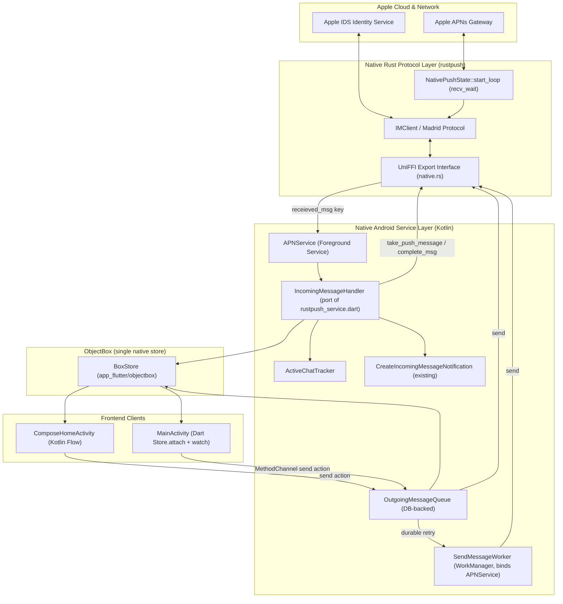
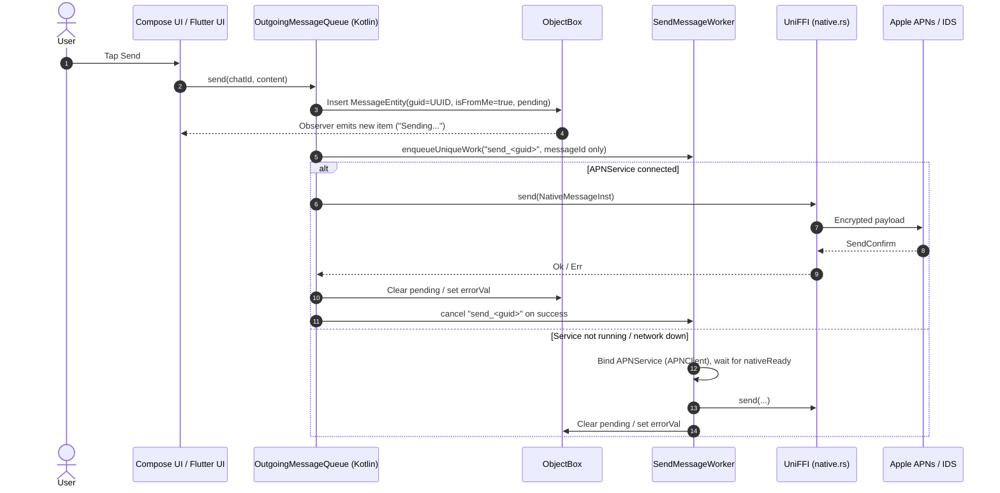
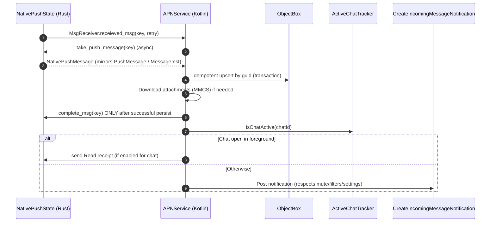

# OpenBubbles Service Transition Plan: Flutter to Pure Native Android & Rust

**Document Version:** 1.1.0  
**Status:** Draft architecture plan (under review)  
**Target Architecture:** Kotlin + Jetpack Compose + ObjectBox Kotlin + Direct UniFFI Rust (rustpush)  
**Primary Authors:** OpenBubbles Core Architecture Team  

> **Note on numbers:** Any latency, memory or APK size figures in this document are *targets to measure*, not measured results. Phase 0 sets up the baseline benchmarks.

---

## 1. Executive Summary & Problem Statement

### 1.1 Context and Technical Debt
OpenBubbles currently uses a hybrid architecture. The core protocol engine (`rustpush`) talks to Apple's Push Notification Service (APNs) and Identity Services (IDS), while background message processing, queueing and UI rendering are tied to Flutter and Dart isolates.

Flutter worked well for cross-platform prototyping, but its service model on Android causes real performance and reliability problems:

1. **Headless `FlutterEngine` cold-start latency:**  
   When the app is not in the foreground and a push arrives, `APNService.receievedMsg` calls `DartWorker.callMethod("APNMsg", ...)`. The worker has to boot a Flutter engine and a Dart isolate, then complete a `MethodChannel` handshake before it can even read the message pointer. This takes seconds, not milliseconds.
2. **Memory pressure / LMK kills:**  
   A headless `FlutterEngine` adds a lot of RSS. On low-end devices, starting one under memory pressure can get the process killed by the Low Memory Killer before the message is saved or the notification is shown.
3. **Split-brain Rust FFI (FRB vs. UniFFI):**  
   - `flutter_rust_bridge` (FRB v2) exposes `rust/src/api/api.rs` (and the type mirrors in `rust/src/api/mirrors.rs`) to Dart only.
   - `UniFFI` exposes `rust/src/native.rs` (`NativePushState`, `MsgReceiver`, keychain, etc.) to Kotlin.  
   Because Kotlin cannot use FRB types, incoming messages are passed to Dart as `u64` keys into `QUEUED_MESSAGES` (sent as strings over `MethodChannel`). Dart then calls `ptr_to_dart` / `complete_msg` through FRB.
4. **MethodChannel round-trips for native sends:**  
   `MessageSender.kt` writes the outgoing message to ObjectBox, then calls `DartWorker.callMethod("execute-rust-send")`. Dart reads the message back from ObjectBox and sends it through FRB.
5. **Duplicated database schemas:**  
   Models exist in Dart (`lib/database/models.dart` + `lib/objectbox-model.json`) and are mirrored in Kotlin (`com.bluebubbles.messaging.socialite.model.ObjectBoxEntities.kt`). Every schema change has to be made in both places. **This stays true for as long as the Flutter UI ships.** It only goes away when Flutter is removed.

---

### 1.2 The Core Solution: Architectural Role Inversion

```
[Legacy Hybrid Model]
Android OS ──► APNService.kt ──(spawns)──► Headless FlutterEngine ──► Dart Services ──(FRB)──► Rust
                                             ▲
Compose UI / Native Activity ────────────────┘ (Must invoke DartWorker to send!)

========================================================================================

[New Native-First Architecture]
Android OS / Push Sockets ──► APNService.kt ──(Direct UniFFI)──► Rust Engine (rustpush)
                                     │
                                     ▼
                      ObjectBox (Single Source of Truth, one native store)
                         ▲                               ▲
                         │ Kotlin Flow                   │ Dart Store.attach + watch()
                         │                               │
                 [Jetpack Compose UI]           [Flutter UI (Client)]
                 (ComposeHomeActivity)          (MainActivity - Foreground Only)
```

#### Key Architecture Principles:
1. **Native Android is the backend:**  
   For messaging, the Android layer (`APNService`, the outgoing queue, WorkManager, ObjectBox Kotlin and UniFFI) becomes the single source of truth. It does not depend on Flutter.
2. **Zero headless Flutter:**  
   When the app is in the background or killed, **no FlutterEngine is ever started**. This applies to *every* path that uses `DartWorker` / `DartWorkManager` today, not only APNs (see §6.1).
3. **Flutter is a foreground client:**  
   While it still exists, Flutter reads data straight from the shared ObjectBox store (it already uses `Store.attach`). It sends *actions* to native code over a small `MethodChannel`. An `EventChannel` is only used for ephemeral state that is never stored in the database, such as typing indicators.
4. **FRB stays until Flutter no longer needs it:**  
   FRB and UniFFI already live side by side in the same `cdylib`. Flutter uses FRB for much more than messaging (setup/registration, Apple ID login, FaceTime, Find My, passwords/keychain, shared albums, StatusKit, CloudKit message sync, profiles). FRB removal is therefore the **last** step, not the first.

---

## 2. Architecture Comparison

### 2.1 Component Comparison Matrix

| Responsibility | Legacy Architecture | New Native Architecture |
| :--- | :--- | :--- |
| **Push Reception** | APNService ➔ DartWorker (headless engine) ➔ `ptr_to_dart` via FRB | APNService ➔ coroutine on `Dispatchers.IO` ➔ UniFFI `take_push_message` |
| **Rust FFI Layer** | Split: FRB (Dart) + UniFFI (Kotlin) | UniFFI for all native callers; FRB kept only for remaining Flutter UI until removal |
| **Data Storage** | One ObjectBox store, opened by Dart and attached by Kotlin | Same store, opened by Kotlin and attached by Dart (`Store.attach`); same files and directory |
| **Outgoing Pipeline** | Kotlin ➔ `DartWorker("execute-rust-send")` ➔ Dart `OutgoingQueue` ➔ FRB `send()` | UI ➔ `OutgoingMessageQueue` (DB-backed) ➔ UniFFI `send()`; WorkManager only for durability |
| **Receipts / Typing** | Rust ➔ Dart `rustpush_service.dart` ➔ ObjectBox Dart | Rust ➔ APNService ➔ ObjectBox Kotlin (receipts) / in-memory flow (typing) |
| **Background Notifications** | Dart `MessageHelper.handleNotification` ➔ MethodChannel ➔ `CreateIncomingMessageNotification.kt` | APNService ➔ `CreateIncomingMessageNotification.kt` directly (existing code reused) |
| **Flutter Frontend** | Host of all business logic | Presentation client during migration, then removed |

---

### 2.2 System Architecture Diagram



---

### 2.3 Detailed Pipeline Sequence Diagrams

#### Sequence A: Outgoing Message Flow
rustpush message IDs are **client-generated UUIDs** (`MessageInst.id`). The final GUID is known before anything goes on the wire, so there are **no temp GUIDs and no reconciliation step**. The message row is written with its real GUID and a "pending" state.



#### Sequence B: Incoming Push Flow


If anything throws before `complete_msg`, the key stays in `QUEUED_MESSAGES`. The existing Rust retry loop re-emits it every 30 s, up to 5 times. That is why persistence **must** be idempotent by GUID.

---

## 3. Phase 0: Baseline & Safety Net

Before changing behaviour:
- [ ] Measure the current baseline: time from push to notification with the app killed, background RSS, and APK size.
- [ ] Write down every `DartWorker` / `DartWorkManager` entry point (§6.1) and every `PushMessage` / `Message` variant that `rustpush_service.dart` handles. **This list is the functional spec for the native port.**
- [ ] Align ObjectBox versions. `objectbox_flutter_libs` (4.0.3 in `pubspec.lock`) bundles its own `objectbox-android`, while Gradle uses `objectboxVersion = '4.0.0'`. Both runtimes must load the same native library and attach to the same store.

---

## 4. Phase 1: Expand UniFFI (FRB stays)

### 4.1 Approach: Mirror rustpush types, don't invent lossy ones
Today `PushMessage` (in `api.rs`) has these variants: `IMessage(MessageInst)`, `SendConfirm`, `RegistrationState`, `NewPhotostream`, `FaceTime`, `StatusUpdate`, `Idms`, `TwoFaAuthEvent`, `CircleFinishEvent` and `BeaconShared`. Delivered/read receipts, typing, reactions, edits, unsends, renames, participant and icon changes, SMS activation/confirm, peer cache invalidation and so on are all **variants of `rustpush::Message` inside `MessageInst`**. They are not top-level push types.

Do not hand-write a small `NativeIncomingMessage` that only holds text plus attachments. Instead, expose the real data model to Kotlin, the same way `mirrors.rs` does for FRB. Use UniFFI `Record`/`Enum` mirrors (or `uniffi::remote` where possible) for `MessageInst`, `ConversationData`, `Message`, `NormalMessage`, `MessageParts`, `Attachment`, `ReactMessage`, `EditMessage`, `UnsendMessage` and so on. The conversion logic stays in Kotlin and is ported from `rustpush_service.dart`.

### 4.2 Pointer handling (`rust/src/native.rs`)
Replace FRB's `ptr_to_dart` / `complete_msg` with UniFFI equivalents. Keep the existing `QUEUED_MESSAGES` + re-emit design. Make the methods `async` instead of using `RUNTIME.block_on` from a JNI thread.

```rust
// Implemented in rust/src/native.rs. Each method body runs via `RUNTIME.spawn(..).await`, so no
// second tokio runtime is created (avoid `async_runtime = "tokio"`, which brings its own).
// The real error type is `NativeMsgError`; `send` returns the sent NativeMessageInst.
#[uniffi::export]
impl NativePushState {
    /// Returns a mirrored copy of the queued message without removing it.
    pub async fn take_push_message(&self, key: u64) -> Option<NativePushMessage> {
        let guard = QUEUED_MESSAGES.lock().await;
        guard.1.get(&key).map(NativePushMessage::from)
    }

    /// Call only after the message has been durably handled.
    pub async fn complete_msg(&self, key: u64) {
        QUEUED_MESSAGES.lock().await.1.remove(&key);
    }

    /// Sends any MessageInst (normal message, reaction, read receipt, typing, edit, unsend, ...).
    /// Read receipts and typing indicators are just Message variants, so no dedicated methods are needed.
    pub async fn send(&self, msg: NativeMessageInst) -> Result<(), NativeSendError> {
        let mut inst: MessageInst = msg.try_into()?;
        let ack = self.state.client.send(&mut inst).await?;
        // await SendConfirm handle if present, map errors
        ...
    }

    pub async fn download_attachment(&self, att: NativeAttachment, path: String,
                                     progress: Arc<dyn NativeProgressCallback>) -> Result<(), NativeSendError>;
    pub async fn upload_attachment(&self, path: String, mime: String, uti: String, name: String,
                                   progress: Arc<dyn NativeProgressCallback>) -> Result<NativeAttachment, NativeSendError>;
}

#[derive(Debug, thiserror::Error, uniffi::Error)]
pub enum NativeSendError { /* map PushError variants; keep retryable vs permanent distinguishable */ }
```

Notes:
- Conversations in rustpush are identified by `ConversationData` (participants, sender handle, `sender_guid`, group name). There is no "chat GUID". Kotlin builds `ConversationData` from `ChatEntity` / handles, matching how Dart does it today.
- Use a typed `uniffi::Error` instead of `Result<_, String>`, so the outgoing queue can tell retryable errors from permanent ones.
- The non-messaging features (FaceTime, Find My, passwords, etc.) are exposed through UniFFI incrementally, as each Compose screen replaces its Flutter screen.

---

## 5. Phase 2: Native Data Layer (ObjectBox Kotlin)

### 5.1 Schema Stability
The Kotlin entities (`ChatEntity`, `MessageEntity`, `AttachmentEntity`, `HandleEntity`, ...) must keep the exact entity/property UIDs and DB names from `lib/objectbox-model.json`. While Flutter still ships, **the Dart model stays authoritative**. A schema change is made in Dart first, then mirrored in Kotlin, and both are released together. If they don't match, one runtime will try to rewrite the model on open.

Move the entities from `socialite.model.ObjectBoxEntities.kt` into `com.bluebubbles.messaging.objectbox`.

### 5.2 Store Location & Ownership
Keep the existing directory: `context.getDir("flutter", MODE_PRIVATE)/objectbox` (i.e. `app_flutter/objectbox`). Do not move it. `ObjectBox.init` already opens it. Make sure `Application.onCreate` (or `APNService.onCreate`) opens it **before** Flutter starts, so Dart's existing `Store.attach` path in `lib/database/database.dart` succeeds.

### 5.3 Reactive Queries
```kotlin
fun <T> Query<T>.asFlow(): Flow<List<T>> = callbackFlow {
    val subscription = subscribe().observer { trySend(it) }   // observer emits initial result itself
    awaitClose { subscription.cancel() }
}.flowOn(Dispatchers.IO)
```
- `observeMessages` must apply the limit in the query (`find(offset, limit)` inside a custom subscription, or a paging source). Running `find()` on all rows and then calling `take(limit)` loads the whole chat history on every change.
- `buildChat` currently runs several queries per chat (latest message, unread count). Keep this out of a per-emission `map` over every chat. Consider storing denormalised `latestMessage`/unread fields, as Dart already does with `dbOnlyLatestMessageDate`.

### 5.4 No GUID Reconciliation
Remove the planned `reconcileGuid` / `temp-` ➔ `srv-` swapping. Outgoing messages use their final rustpush UUID from the moment they are inserted. Attachments likewise use their final GUID. Only the existing SMS "staging GUID" behaviour (`stagingGuid` in `reflectMessageDyn`) needs to be ported as-is.

---

## 6. Phase 3: Native Incoming Pipeline

### 6.1 Inventory of Headless-Flutter Entry Points
`DartWorker` can only be deleted once **all** of these are native, or explicitly dropped:

| Caller | Purpose |
| :--- | :--- |
| `APNService.receievedMsg` | `APNMsg`: incoming rustpush messages |
| `APNService.launchAgent` (`SMSObserver`) | `SMSMsg`: SMS relay/forwarding |
| `MessageSender.kt` | `execute-rust-send` |
| `InternalIntentReceiver.kt` | Notification inline reply / mark as read |
| `BlueBubblesFirebaseMessagingService.kt` | FCM (BlueBubbles server mode) |
| `UnifiedPushReceiver.kt` | UnifiedPush |
| `SocketIOForegroundService.kt` | Socket.IO (BlueBubbles server mode) |

**Decision:** BlueBubbles-server mode (FCM / Socket.IO / UnifiedPush) is **dropped**. Those paths are deleted along with `DartWorker`; they are not ported. The full method-by-method list is in `SERVICE_TRANSITION_INVENTORY.md` §4.

### 6.2 `APNService.receievedMsg`
```kotlin
override fun receievedMsg(msg: ULong, retry: ULong) {
    scope.launch {
        val state = pushState ?: return@launch          // Rust will re-emit later
        val payload = state.takePushMessage(msg) ?: return@launch
        try {
            IncomingMessageHandler.handle(this@APNService, state, payload)  // idempotent by guid
            state.completeMsg(msg)
        } catch (e: Exception) {
            Log.e("APNService", "Failed to handle $msg (retry $retry)", e)
            // do NOT complete: the Rust re-emit loop will retry
        }
    }
}
```

`IncomingMessageHandler` is a port of the relevant parts of `rustpush_service.dart` (`reflectMessageDyn` and the related code). That file (~4k lines) is the spec. This includes reactions/tapbacks, edits, unsends, renames, participant/icon changes, delivered/read/played receipts, typing, SMS handling, `NotifyAnyways`, error messages, peer cache invalidation, profile sharing, `RegistrationState`, `FaceTime` and `StatusUpdate`.

Concurrency: each `receievedMsg` currently launches independently. Process messages **per conversation in order**, for example with a `Mutex` or a single-consumer channel per chat. Otherwise edits/reactions can be applied before their target message has been inserted.

Attachments: Dart never downloads during push handling. It stores the rustpush `Attachment` as plist XML in `metadata.rustpush` and downloads lazily (`autoDownload` / `onlyWifiDownload`). The native port stores the same metadata, then either downloads lazily through `download_attachment` or does an auto-download *after* the message row is saved. A slow download must never block persistence or the notification.

### 6.3 Notifications
Reuse the existing native notification code (`CreateIncomingMessageNotification.kt`, `InternalIntentReceiver.kt` for reply/mark-read, `PushShareTargetsHandler.kt` for shortcuts) and call it directly, instead of writing a parallel `NativeNotificationManager`. The logic currently in Dart `MessageHelper.handleNotification` (mute, filtering unknown senders, group naming, reactions text, quiet delivery, Focus/zen) must be ported. Notification taps and replies should open whichever UI is the current launcher.

Read receipts on incoming messages must respect the global and per-chat "send read receipts" settings. Never send them unconditionally.

---

## 7. Phase 4: Native Outgoing Pipeline

### 7.1 Design: DB as the queue
Two separate paths (an in-memory channel *and* a WorkManager fallback that duplicates the send logic) create more ways to fail. Use one path:

1. The UI calls `OutgoingMessageQueue.send(chatId, content)`. The message is inserted with its final UUID and marked pending. Attachments are copied into the attachment directory first.
2. Enqueue `SendMessageWorker` with `enqueueUniqueWork("send_$guid", KEEP, ...)`. Pass **only the message's DB id** (WorkManager `Data` is limited to 10 KB, so text and attachments stay in the DB). Mark it `setExpedited(RUN_AS_NON_EXPEDITED_WORK_REQUEST)` and require `NetworkType.CONNECTED`.
3. If `APNService` is already bound and ready, the queue can run the same `sendPending(messageId)` function immediately. The worker then becomes a no-op because it sees the message is no longer pending.
4. `sendPending` is the **only** place that calls UniFFI `send`. Sends are serialized per chat to keep order.
5. The worker must **bind/start `APNService`** (via the existing `APNClient`) and wait for `nativeReady`. Without this, a killed app means `Result.retry()` forever.
6. Retryable errors lead to `Result.retry()` with exponential backoff. Permanent errors or exhausted retries set `errorVal`, and the user can resend manually, matching current behaviour.
7. On `APNService` start, re-enqueue any messages still marked pending, in case work was lost.

Typing indicators and read receipts are fire-and-forget `send` calls. They are not queued.

---

## 8. Phase 5: Media & Attachment Handling

### 8.1 Storage
Keep the existing attachment location: `app_flutter/attachments/<guid>/<filename>` (`getDir("flutter")`). `MessageSender.kt` and the Dart code already use it. Moving it to `files/attachments` would require migrating every existing attachment and gains nothing.

### 8.2 Coil
- HEIC/HEIF: Coil's `ImageDecoderDecoder` uses the platform decoder on API 28+. For older APIs, the existing `services/system/HeifDecoder.kt` can be wrapped as a Coil decoder.
- Video thumbnails: add `io.coil-kt:coil-video` (`VideoFrameDecoder`).
- Use attachment GUIDs as memory/disk cache keys.

### 8.3 Apple CAF Voice Messages
Android's `MediaExtractor` **does not support the CAF container**, so the plan "`MediaExtractor` unpacks CAF" does not work. Also, re-encoding to AAC is a pointless lossy transcode.

- **Incoming:** write a small CAF demuxer (the format is simple: `desc` / `pakt` / `data` chunks) in Kotlin or Rust. iMessage voice notes are Opus, so **remux** the packets into Ogg/Opus without decoding. Android plays Ogg/Opus natively via `MediaPlayer`/ExoPlayer, with no transcode needed. Only fall back to `MediaCodec` decoding for non-Opus CAF payloads.
- **Outgoing:** Apple clients expect CAF/Opus voice notes. Port whatever the current Dart pipeline does to produce them before Flutter is removed.

---

## 9. Phase 6: Flutter Frontend Interop (Inverted Bridge)

### 9.1 Data: read ObjectBox directly
Flutter already attaches to the same native store. Once Kotlin writes the data, Dart `query.watch()` / existing GetX observers pick up the changes. There is **no need** to stream database rows over an `EventChannel`. (The previous draft's `chats_updated {count}` event carried no usable data anyway.) Flutter's in-memory caches (e.g. `MessagesService`, chat list controller) must be checked so that they refresh from DB watches rather than relying on the Dart incoming queue to push into them.

### 9.2 Actions: `MethodChannel` (`com.bluebubbles.messaging/native_service`)
| Method | Arguments | Returns |
| :--- | :--- | :--- |
| `sendMessage` | `{chatId, text, attachments[], replyGuid?, replyPart?, effect?, subject?}` | `guid` |
| `sendReaction` / `editMessage` / `unsendMessage` | target guid + params | `Boolean` |
| `sendReadReceipt` | `{chatId, messageGuid}` | `Boolean` |
| `sendTyping` | `{chatId, isTyping}` | `Boolean` |
| `retrySend` | `{messageGuid}` | `Boolean` |

Register this on the existing `MethodCallHandler` channel, or alongside it, rather than adding a separate plugin with its own lifecycle.

### 9.3 Ephemeral events: `EventChannel` (`com.bluebubbles.messaging/native_events`)
Only for state that is not stored in the DB: `typing_status`, connection/registration state, send progress. The sink must be cleared in `onCancel`, and its collection jobs cancelled.

### 9.4 Dart-side changes
- `RustPushBackend` send paths delegate to `native_service`. The Dart `OutgoingQueue` / `IncomingQueue` and the `APNMsg` handler are disabled for rustpush.
- Non-messaging FRB usage (setup, FaceTime, Find My, ...) stays on FRB until it is reimplemented in Compose.

### 9.5 Zero Headless Flutter Guarantee
Once §6.1 is complete, nothing on Android ever creates a `FlutterEngine` except `MainActivity`. Add a debug assertion or lint check so that `DartWorker` cannot creep back in.

---

## 10. Phase 7: Deprecation & Cleanup

Only after Compose covers every feature the Flutter UI provides:

1. **Dart services:** `lib/services/rustpush/rustpush_service.dart`, `lib/services/backend/action_handler.dart`, `lib/services/backend/queue/*`, `lib/services/backend/java_dart_interop/*`. Then the rest of `lib/` and the Flutter Gradle integration.
2. **Android bridge:** `DartWorker.kt`, `DartWorkManager.kt`, `MessageSender.kt` (replaced by `OutgoingMessageQueue`) and the Flutter parts of `MethodCallHandler.kt`.
3. **Rust FRB:** remove `flutter_rust_bridge` from `rust/Cargo.toml`. Delete `rust/src/frb_generated*.rs` and `flutter_rust_bridge.yaml`. Remove the `frb_generated::FLUTTER_RUST_BRIDGE_HANDLER` usage in `native.rs`, the `#[frb]` attributes, `DartFnFuture` usages (e.g. `get_entitlements`) and `mirrors.rs`, or convert it to UniFFI mirrors.
4. **Manifest:** make `ComposeHomeActivity` the launcher and remove `MainActivity`. **Edit the existing manifest. Do not replace it.** It contains FaceTime, credentials/autofill, intent receivers, share targets and other components that must stay.
5. **Database:** the Kotlin model in `objectbox-models/` becomes authoritative. `lib/objectbox-model.json` is retired.

---

## 11. Execution Roadmap & Checklist

### Milestone 0: Baseline
- [ ] Benchmarks (cold push ➔ notification, background RSS, APK size). *Needs a physical device; not done yet.*
- [x] Full inventory of `rustpush_service.dart` message handling and `DartWorker` callers → `SERVICE_TRANSITION_INVENTORY.md`.
- [x] ObjectBox native versions aligned between Flutter and Gradle (`objectboxVersion = '4.0.3'`, also used for `objectbox-kotlin`).

### Milestone 1: UniFFI Expansion (FRB untouched)
- [x] UniFFI mirrors for `MessageInst` / `Message` / `ConversationData` / attachments (`rust/src/native_types.rs`). Deep types (extension apps, link meta, profiles, transcript backgrounds) are opaque objects with getters.
- [x] Exported on `NativePushState` (`rust/src/native.rs`): `take_push_message`, `complete_msg`, `send`, `get_handles`, `get_my_phone_handles`, `download_attachment`, `download_mmcs`, `upload_attachment`. Also the free function `new_message_inst`. All are async on the shared `RUNTIME`, with the typed error `NativeMsgError` (Kotlin `NativeMsgException.Retryable/Permanent/Invalid`).
- [x] Regenerate bindings with `./gradlew rustUniffiKotlin`.
- **Acceptance:** Rust unit tests round-trip `MessageInst` through the mirrors (`cargo test --lib native_types`). `:app:compileProdDebugKotlin` builds against the new bindings. Nothing calls the new API yet, so Flutter behaviour is unchanged.
- Still to add when Milestone 3 needs them: `certify_delivery`, `convert_token_to_uuid`, `fetch_profile`, `parse_transcript_poster`, validate targets.

### Milestone 2: Native Data Layer
- [x] Entities moved to `com.bluebubbles.messaging.objectbox` (`ObjectBoxEntities.kt`). The Kotlin model matches `lib/objectbox-model.json` exactly: all 9 entities, every property id, UID, type, flag, index and relation. The `verifyObjectBoxModels` Gradle task now fails any build where the two drift apart. It runs after kapt and before packaging.
- [x] **The JSON models are not enough.** They don't record the index type. Java's `@Index` on a String defaults to a *hash* index, while Dart's guid indexes are *value* indexes. The JSON files matched, yet the first native build read Dart's value-index entries as hash entries and failed with `FileCorruptException: Illegal index entry size`. Fixed with `@Index(type = IndexType.VALUE)` on `Chat/Message/Attachment.guid`, and with a hash index without `@Unique` on `Contact.stringId`. `verifyObjectBoxSchemas<Variant>` now compares the generated `MyObjectBox.java` with `lib/objectbox.g.dart`, matching every property by UID: type, storage-relevant flags (index type, uniqueness, ID) and index id. It fails the build on any difference. Negative-tested against the broken build: it reports all 4 mismatches.
- [x] Kotlin opens the store first: `BlueBubblesApplication.onCreate` → `ObjectBox.init`. Dart's existing `Store.isOpen` → `Store.attach` path then takes over. If the native open fails, the app does not crash; Dart opens the store as before.
- [x] Open options match Dart: max DB size is 5 GB, as in Dart's `openStore`. The Java default was 1 GB, which would have broken large databases whenever Kotlin opened first.
- [x] Cross-runtime change notifications: `StoreChanges` registers an `obx_observe` observer through the C API (`obx_store_wrap` on the Java store handle). Commits from Dart therefore update Compose too; Java `store.subscribe()` only sees Java commits.
- [x] `ChatRepository.observeChats()` / `observeMessages(chatId, limit)`. Only `limit` rows are loaded; paging raises the limit. `ChatListScreen` and `ChatScreen` collect these flows.
- [x] `ObjectBox.update<T>(id) { }` runs read-modify-write inside a write transaction, so a Kotlin update cannot overwrite a change Dart committed in between. Kotlin code must use it (or `runInTx`) for every update of an existing object.
- [ ] Device verification on an existing user database (see acceptance).
- **Acceptance:**
  - On a device upgraded from a Flutter-only build, all chats and messages are still present.
  - The Flutter UI works: logs show "Successfully attached to an existing ObjectBox store".
  - A message received while Compose is open appears without reopening the screen.
  - A message written from Kotlin appears in Flutter.

### Milestone 3: Native Incoming Pipeline
- [ ] `IncomingMessageHandler` covers every variant in the inventory, is idempotent by GUID and ordered per chat.
- [ ] `complete_msg` only after a successful persist.
- [ ] Attachment downloads.
- [ ] Notifications through the existing native notification code, with the Dart notification rules ported.
- [ ] `APNMsg` no longer goes to Dart (foreground or background).
- **Acceptance:** With the app killed, an incoming iMessage (text, reaction, edit, unsend, attachment) is stored and notified with no `FlutterEngine` created. Latency is compared against the Milestone 0 baseline.

### Milestone 4: Native Outgoing Pipeline
- [ ] `OutgoingMessageQueue` + `SendMessageWorker` (DB id only, binds `APNService`).
- [ ] Compose `ChatInputArea` and notification inline reply use it.
- [ ] `execute-rust-send` removed.
- **Acceptance:** Messages show "Sending..." at once and become sent on confirm. Messages queued offline or while the app is killed are delivered once connectivity returns, in order.

### Milestone 5: Flutter Interop
- [ ] `native_service` MethodChannel + `native_events` EventChannel.
- [ ] Dart rustpush send/receive paths switched over; Dart queues disabled.
- **Acceptance:** Flutter and Compose can be used interchangeably on the same store with no duplicate or missed messages.

### Milestone 6: Remaining Headless Paths
- [ ] SMS relay (`SMSMsg`), notification reply/mark-read and FCM/UnifiedPush/Socket.IO are ported or explicitly removed.
- [ ] `DartWorker.kt` / `DartWorkManager.kt` deleted.

### Milestone 7: Media
- [ ] Coil HEIC + video thumbnails.
- [ ] CAF demuxer + Ogg/Opus remux (incoming); CAF/Opus generation (outgoing).

### Milestone 8: Flutter & FRB Removal
- [ ] Compose feature parity, covering at least setup/login, settings, FaceTime, Find My, passwords and shared albums.
- [ ] Delete Dart services, FRB, Flutter build integration; update manifest.
- **Acceptance:** No Flutter/FRB artifacts in the APK, and no regressions in iMessage delivery. Background RSS and APK size are compared against the Milestone 0 baseline.
